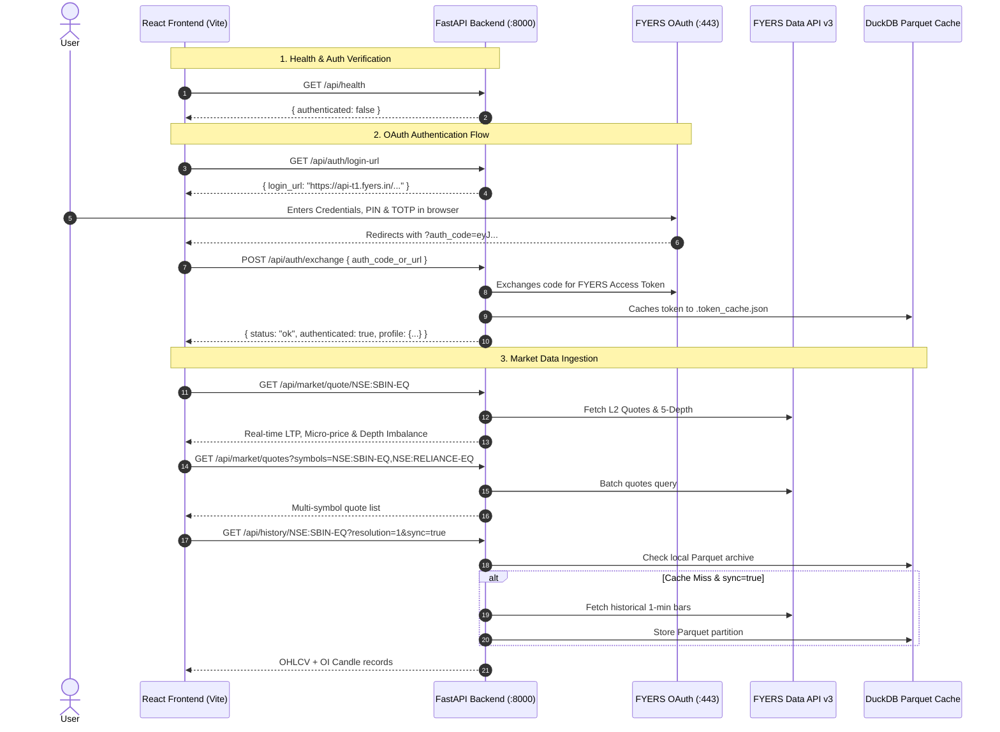

# FYERS Authentication & Market Data Guide (End-to-End API Reference)

A complete step-by-step developer guide for starting the backend server, authenticating with FYERS API v3, and fetching real-time Level-2 market data and historical bars for a **single stock** or a **list of stocks**.

This architecture is designed so that both **terminal/curl workflows** and **React TypeScript frontend applications** interact with the exact same REST endpoints.

---

## Architecture & Data Flow



---

## 1. Starting the Server

From the repository root (`quant-trading-platform`):

```bash
# 1. Activate Python virtual environment
source .venv/bin/activate

# 2. Run FastAPI development server with live reload
uvicorn backend.app.main:app --host 0.0.0.0 --port 8000 --reload
```

- **Base URL**: `http://127.0.0.1:8000`
- **Swagger Interactive Docs**: `http://127.0.0.1:8000/docs`
- **CORS Allowed Origins**: `http://localhost:5173`, `http://127.0.0.1:5173` (Vite dev server)

---

## 2. Authentication Step-by-Step

### Step 2.1 — Check Authentication Health
Before initiating login, check if a valid, unexpired token is already present:

```bash
curl http://127.0.0.1:8000/api/health
```

**Expected response if not authenticated:**
```json
{
  "status": "unauthenticated",
  "authenticated": false,
  "profile": null,
  "error": "Access token not found or expired",
  "timestamp": 1762505000.0
}
```

---

### Step 2.2 — Get OAuth Login URL
Retrieve the official FYERS authorization URL:

```bash
curl http://127.0.0.1:8000/api/auth/login-url
```

**Response:**
```json
{
  "login_url": "https://api-t1.fyers.in/api/v3/generate-authcode?client_id=5FSCL524SX-100&redirect_uri=https%3A%2F%2Ftrade.fyers.in%2Fapi-login%2Fredirect-uri%2Findex.html&response_type=code&state=quant_platform"
}
```

1. Open this `login_url` in your browser.
2. Log in with your FYERS User ID / Mobile, PIN, and 2FA TOTP.
3. FYERS redirects your browser to:
   ```
   https://trade.fyers.in/api-login/redirect-uri/index.html?auth_code=eyJhbGciOi...&state=quant_platform
   ```

---

### Step 2.3 — Exchange Auth Code for Access Token

You can execute the exchange through any of these three methods:

#### Method A: Reading from `backend/.env` (Zero Payload)
If you saved `FYERS_AUTH_CODE=eyJ...` in `backend/.env`:
```bash
curl -X POST http://127.0.0.1:8000/api/auth/exchange
```

#### Method B: Explicit JSON Body
Send the copied redirected URL or `auth_code`:
```bash
curl -X POST http://127.0.0.1:8000/api/auth/exchange \
  -H "Content-Type: application/json" \
  -d '{"auth_code_or_url": "https://trade.fyers.in/api-login/redirect-uri/index.html?auth_code=eyJ...&state=quant_platform"}'
```

#### Method C: Standalone Interactive CLI Script
```bash
.venv/bin/python backend/scripts/authorize_and_fetch.py
```

**Successful Exchange Response:**
```json
{
  "status": "ok",
  "authenticated": true,
  "profile": {
    "name": "DEEPAK PAHAWA",
    "fy_id": "XD17919",
    "email": "user@example.com",
    "mobile": "98XXXXXXXX",
    "totp_enabled": true
  },
  "message": "Successfully authenticated and acquired FYERS access token."
}
```

Once exchanged, the token is saved to `.token_cache.json` and remains valid for ~24 hours across all backend requests.

---

## 3. Fetching Market Data for a Particular Stock

> **FYERS Symbol Format**: `EXCHANGE:SYMBOL-SERIES`  
> Examples: `NSE:SBIN-EQ`, `NSE:RELIANCE-EQ`, `NSE:TCS-EQ`, `NSE:INFY-EQ`, `NSE:NIFTY50-INDEX`, `NSE:NIFTYBANK-INDEX`.

### 3.1 Live Quote & Microstructure Metrics (LTP, Depth Imbalance, Micro-price)
Fetches real-time Level-2 quote with top-5 order depth:

```bash
curl "http://127.0.0.1:8000/api/market/quote/NSE:SBIN-EQ"
```

**Response:**
```json
{
  "status": "ok",
  "symbol": "NSE:SBIN-EQ",
  "data": {
    "symbol": "NSE:SBIN-EQ",
    "ltp": 785.40,
    "change": 4.25,
    "change_pct": 0.54,
    "open": 782.00,
    "high": 789.50,
    "low": 781.10,
    "prev_close": 781.15,
    "volume": 8421030,
    "depth_imbalance": 0.142857,
    "micro_price": 785.4320,
    "normalized_spread": 0.000127,
    "bid_depth": [...],
    "ask_depth": [...]
  }
}
```

### 3.2 Historical OHLCV Candles (Intraday & Daily with DuckDB Cache)
Queries local DuckDB parquet cache first. If empty and `sync=true`, fetches from FYERS and caches automatically:

```bash
# 1-minute historical bars (latest 3 days synced)
curl "http://127.0.0.1:8000/api/history/NSE:SBIN-EQ?resolution=1&sync=true"

# 5-minute bars
curl "http://127.0.0.1:8000/api/history/NSE:SBIN-EQ?resolution=5&sync=true"

# Daily bars with custom date range
curl "http://127.0.0.1:8000/api/history/NSE:SBIN-EQ?resolution=D&range_from=2024-01-01&range_to=2024-12-31&sync=true"
```

**Response Format:**
```json
{
  "status": "ok",
  "symbol": "NSE:SBIN-EQ",
  "resolution": "1",
  "count": 1125,
  "candles": [
    [1714535700, 781.5, 782.0, 781.0, 781.8, 15420, 0],
    [1714535760, 781.8, 782.5, 781.6, 782.4, 18900, 0]
  ]
}
```
*Candle structure: `[epoch_timestamp, open, high, low, close, volume, open_interest]`*

### 3.3 60-Bar Multivariate TFT Feature Sequence
Generates a normalized 60-bar multivariate feature matrix for deep learning models:

```bash
curl "http://127.0.0.1:8000/api/market/tft/NSE:SBIN-EQ?days=3"
```

---

## 4. Fetching Market Data for a List of Stocks

### 4.1 Multiple Quotes in a Single Request (`/api/market/quotes`)
Pass multiple symbols as a comma-separated list:

```bash
curl "http://127.0.0.1:8000/api/market/quotes?symbols=NSE:SBIN-EQ,NSE:RELIANCE-EQ,NSE:ICICIBANK-EQ,NSE:TCS-EQ"
```

**Response:**
```json
{
  "status": "ok",
  "count": 4,
  "data": [
    {
      "symbol": "NSE:SBIN-EQ",
      "ltp": 785.40,
      "change": 4.25,
      "change_pct": 0.54,
      "volume": 8421030,
      "depth_imbalance": 0.142857,
      "micro_price": 785.4320
    },
    {
      "symbol": "NSE:RELIANCE-EQ",
      "ltp": 2980.50,
      "change": -12.30,
      "change_pct": -0.41,
      "volume": 4125890,
      "depth_imbalance": -0.082145,
      "micro_price": 2980.3510
    }
  ]
}
```

### 4.2 Unified Market Overview (`/api/market/overview`)
Returns user profile, available margin/balance, exchange operating status, and real-time quotes for multiple stocks in one call:

```bash
curl "http://127.0.0.1:8000/api/market/overview?symbols=NSE:SBIN-EQ,NSE:RELIANCE-EQ,NSE:NIFTY50-INDEX"
```

### 4.3 List Cached Historical Symbols (`/api/symbols`)
Lists all tickers that currently have local DuckDB Parquet candle archives:

```bash
curl "http://127.0.0.1:8000/api/symbols"
```

---

## 5. React / TypeScript Frontend Integration

Below is the standard integration service (`src/services/fyersApi.ts`) that matches the backend endpoints:

```typescript
// frontend/src/services/fyersApi.ts

const API_BASE = "http://127.0.0.1:8000/api";

export interface StockQuote {
  symbol: string;
  ltp: number;
  change: number;
  change_pct: number;
  open: number;
  high: number;
  low: number;
  prev_close: number;
  volume: number;
  depth_imbalance: number;
  micro_price: number;
  normalized_spread: number;
}

export interface AuthStatus {
  authenticated: boolean;
  profile?: {
    name: string;
    fy_id: string;
    email: string;
  };
}

/** 1. Check if the backend has a valid FYERS session */
export async function checkAuthStatus(): Promise<AuthStatus> {
  const res = await fetch(`${API_BASE}/health`);
  return res.json();
}

/** 2. Fetch the login URL and redirect the user */
export async function initiateOAuthLogin(): Promise<void> {
  const res = await fetch(`${API_BASE}/auth/login-url`);
  const data = await res.json();
  if (data.login_url) {
    window.location.href = data.login_url;
  }
}

/** 3. Exchange the auth_code parameter received after redirect */
export async function exchangeAuthCode(authCodeOrUrl?: string): Promise<boolean> {
  const res = await fetch(`${API_BASE}/auth/exchange`, {
    method: "POST",
    headers: { "Content-Type": "application/json" },
    body: JSON.stringify({ auth_code_or_url: authCodeOrUrl }),
  });
  const data = await res.json();
  return data.authenticated === true;
}

/** 4. Fetch quote for a SINGLE stock */
export async function fetchStockQuote(symbol: string): Promise<StockQuote> {
  const res = await fetch(`${API_BASE}/market/quote/${encodeURIComponent(symbol)}`);
  const json = await res.json();
  return json.data;
}

/** 5. Fetch quotes for a LIST of stocks */
export async function fetchMultipleQuotes(symbols: string[]): Promise<StockQuote[]> {
  const symParam = encodeURIComponent(symbols.join(","));
  const res = await fetch(`${API_BASE}/market/quotes?symbols=${symParam}`);
  const json = await res.json();
  return json.data;
}

/** 6. Fetch historical candlestick bars for TradingView Lightweight Charts */
export async function fetchCandles(
  symbol: string,
  resolution: string = "1",
  sync: boolean = true
) {
  const url = `${API_BASE}/history/${encodeURIComponent(symbol)}?resolution=${resolution}&sync=${sync}`;
  const res = await fetch(url);
  const json = await res.json();
  // Transform [timestamp, open, high, low, close, volume] into Lightweight-Charts format
  return json.candles.map((c: number[]) => ({
    time: c[0],
    open: c[1],
    high: c[2],
    low: c[3],
    close: c[4],
    volume: c[5],
  }));
}
```

---

## 6. Complete REST API Reference

| Method | Endpoint | Query / Body Parameters | Purpose |
| :---: | :--- | :--- | :--- |
| `GET` | `/api/health` | — | Check server and FYERS session health |
| `GET` | `/api/auth/login-url` | — | Generate OAuth login link |
| `POST` | `/api/auth/exchange` | `{"auth_code_or_url": "..."}` *(optional if in `.env`)* | Exchange auth code for access token |
| `GET` | `/api/market/quote/{symbol}` | Path: `symbol` | Real-time quote & 5-depth metrics (single stock) |
| `GET` | `/api/market/quotes` | `symbols=NSE:SBIN-EQ,NSE:TCS-EQ` | Real-time quotes for a **list of stocks** |
| `GET` | `/api/market/overview` | `symbols=...` | Unified account profile, margins, and quotes |
| `GET` | `/api/history/{symbol}` | `resolution`, `range_from`, `range_to`, `sync` | OHLCV candles (DuckDB + auto FYERS sync) |
| `GET` | `/api/symbols` | — | List all locally cached Parquet tickers |
| `GET` | `/api/market/tft/{symbol}` | `days` (default: 2) | 60-bar multivariate feature tensor |
| `GET` | `/api/options/chain/{symbol}` | `expiry` (optional) | Live option chain & QuantLib Greeks |

---

## 7. Operational Troubleshooting

1. **Token Expiry**: FYERS access tokens expire daily around 05:00 AM IST. When `/api/health` returns `"authenticated": false`, repeat Step 2 to generate a new token.
2. **CORS Errors**: The backend already permits `http://localhost:5173` and `http://127.0.0.1:5173`. If running React on a different port, update the `origins` list in [`backend/app/main.py`](file:///Users/deepakpahawa/Documents/Code/quant-trading-platform/backend/app/main.py#L29-L33).
3. **Symbol Suffixes**: Always ensure NSE equities have the `-EQ` suffix (e.g., `NSE:SBIN-EQ`, not `NSE:SBIN`). Indices use `-INDEX` (e.g., `NSE:NIFTY50-INDEX`).
